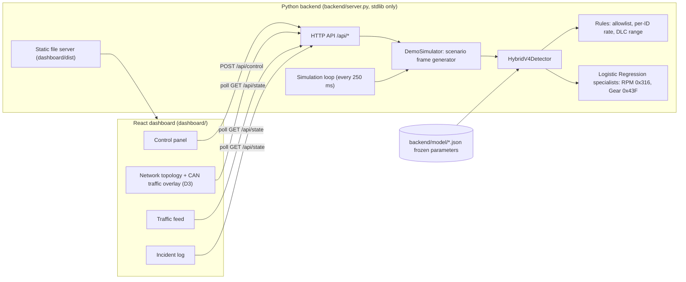

# AutoShield Edge AI

An edge intrusion detection proof of concept for in-vehicle CAN bus networks. It combines deterministic gateway rules with small machine-learning specialists, and every alert comes with an explanation.


## Overview

Modern vehicles connect their electronic control units (ECUs) over the **CAN bus**, a protocol with no built-in authentication. Any node that can transmit can flood the bus (DoS), inject random IDs (fuzzing), or send forged sensor values such as engine RPM or gear position (spoofing). AutoShield explores how a **gateway-side detector** running on edge hardware could catch these attacks locally and respond with an explainable action: `ALLOW`, `RATE_LIMIT`, `DROP` or `ALERT`.

This repository is the **Stage-2 virtual POC**. It runs the frozen **Hybrid-v4** decision logic in a repeatable simulator, with a live browser dashboard that shows CAN traffic, the vehicle network and an incident log. Every alert on screen is produced by real Hybrid-v4 evidence, not a dashboard-only animation.

> This is a **virtual POC simulator**, not physical CAN/HIL evidence. Raspberry Pi 5 and physical CAN validation remain separate deployment work.

## What this build proves

- Six repeatable scenarios: Normal, DoS, Fuzzy, RPM spoof, Gear spoof, and Mix / Combo.
- Every attack is evaluated by Hybrid-v4 evidence.
- DoS is detected by the commissioned per-ID rate policy.
- Fuzzy injection is detected by the CAN-ID allowlist.
- RPM spoof uses the frozen `0x316` Logistic Regression specialist.
- Gear spoof uses the frozen `0x43F` Logistic Regression specialist.
- Start, stop, reset and scenario switching are deterministic.
- The browser reconnects after a backend outage.
- The vehicle digital twin animates live CAN message flow while the simulator runs, and pauses immediately on Stop.
- Windows has a one-command launcher: [`run_autoshield.ps1`](run_autoshield.ps1).

## Architecture



| Component | Responsibility |
|---|---|
| [`backend/server.py`](backend/server.py) | `ThreadingHTTPServer` that exposes the JSON API and serves the built dashboard. A background thread advances the simulator every 250 ms while it is running. |
| [`backend/simulator.py`](backend/simulator.py) | `DemoSimulator`: generates one 100 ms observation window per tick for the selected scenario, evaluates it, keeps the last 80 events and 40 incidents, and supports start, stop, reset and scenario switching. |
| [`backend/hybrid_v4_model.py`](backend/hybrid_v4_model.py) | `HybridV4Detector`: applies the rule policy, then the matching ML specialist, and returns reasons, evidence, ML scores, action and confidence. |
| [`backend/model/`](backend/model/) | Frozen parameters: `hybrid_policy.json` (38-ID allowlist, per-ID rate limits per 100 ms, DLC ranges) and the RPM and Gear specialists (feature means, scales, coefficients, intercept, probability threshold), plus `SHA256SUMS`. |
| [`dashboard/`](dashboard/) | React 19 + Vite + D3 single-page app. It polls `/api/state`, shows connection status (`CONNECTED` / `RECONNECTING`), the ECU topology with animated frames, the traffic feed and the incident log. |
| [`src/`](src/), [`models/`](models/), [`data/`](data/) | Earlier Stage-1 research pipeline: synthetic HCRL-format CAN dataset, sliding-window features, an Isolation Forest baseline and a response engine (see below). |

## How it works

1. **Control.** The dashboard sends `POST /api/control` with `start`, `stop`, `reset` or `scenario`.
2. **Generate a window.** On each tick the simulator builds a 100 ms sample for the active scenario: a CAN ID, a frame count, the normalized DLC, the per-byte feature statistics and the raw frame. In Mix / Combo it rotates through DoS, Fuzzy, RPM and Gear on successive ticks.
3. **Rule stage.** The detector checks the following:
   - If the ID is not in the commissioned allowlist, it adds `UNKNOWN_ID`.
   - If the frame count exceeds the per-ID rate limit, it adds `RATE_LIMIT_EXCEEDED`.
   - If the DLC is outside the commissioned range, it adds `DLC_POLICY_VIOLATION`.
4. **ML stage.** If the ID has a specialist (`0x316` RPM, `0x43F` Gear), the features are standardized with the frozen means and scales and scored by Logistic Regression. A probability above the frozen threshold adds `ML_RPM` or `ML_GEAR`.
5. **Decide.**
   - `UNKNOWN_ID` or a DLC violation leads to `DROP`.
   - A rate violation leads to `RATE_LIMIT`.
   - An ML trigger on otherwise compliant traffic leads to `ALERT`.
   - Anything else is `ALLOW`.

   Rule hits report 0.99 confidence. ML hits report the specialist probability.
6. **Display.** The event, along with an incident if one was raised, is stored with its inference time. The dashboard renders the reason code, readable evidence (for example `38 > 18 frames/100ms` or `p=0.981329 > threshold=0.945376`), and the action.

The RPM and Gear spoof samples are deliberately kept inside the allowlist, rate and DLC policy, so those alerts must come from crossing the **ML threshold**. The simulator builds these samples by shifting each feature along the sign of its specialist coefficient until the probability passes the threshold plus a small margin. The scenarios therefore demonstrate the decision path and the evidence flow, not detection accuracy on unseen traffic.

## Hybrid-v4 evidence

The local demo model files are under [`backend/model/`](backend/model/):

- `hybrid_policy.json`
- `rpm_specialist.json`
- `gear_specialist.json`

The semantic parameters mirror the frozen Hybrid-v4 artifacts audited in the B200 development workspace. The local JSON files are re-serialized for the Windows demo, so their byte hashes are not expected to match the B200 artifact hashes.

The ML specialists use the frozen feature means, scales, Logistic Regression coefficients, intercepts and probability thresholds:

- RPM `0x316`: threshold `0.9453756863`
- Gear `0x43F`: threshold `0.9314904584`

### Expected evidence by scenario

| Scenario | Hybrid-v4 reason | Expected action |
|---|---|---|
| Normal | none | ALLOW |
| DoS | `RATE_LIMIT_EXCEEDED` | RATE_LIMIT |
| Fuzzy | `UNKNOWN_ID` | DROP |
| RPM spoof | `ML_RPM` above frozen threshold | ALERT |
| Gear spoof | `ML_GEAR` above frozen threshold | ALERT |
| Mix / Combo | interleaved `RATE_LIMIT_EXCEEDED` + `UNKNOWN_ID` + `ML_RPM` + `ML_GEAR` | per-vector action |

The dashboard incident log shows the reason code, readable evidence, action, and the specialist probability and threshold when applicable.

## Tech stack

| Layer | Technologies |
|---|---|
| Detection backend | Python 3.11+ standard library only (`http.server`, `threading`, `json`, `math`) |
| Model | Rule policy + Logistic Regression specialists, stored as JSON parameters |
| Dashboard | React 19, Vite 8, D3 7, PapaParse |
| Validation | `unittest`, Playwright (browser and reconnection check), oxlint |
| Stage-1 research | pandas, NumPy, scikit-learn (Isolation Forest), joblib |
| Launcher | PowerShell ([`run_autoshield.ps1`](run_autoshield.ps1)) |

## Project structure

```text
AutoShield-Edge-AI/
├── backend/
│   ├── server.py              # HTTP API + static dashboard server + simulation loop
│   ├── simulator.py           # Scenario generator (normal, dos, fuzzy, rpm, gear, mix)
│   ├── hybrid_v4_model.py     # Hybrid-v4 rules + Logistic Regression specialists
│   └── model/                 # Frozen policy and specialist parameters (JSON) + SHA256SUMS
├── dashboard/                 # React/Vite dashboard
│   ├── src/App.jsx            # Polling loop, state and layout
│   ├── src/components/        # ControlPanel, NetworkTopology, CanTrafficOverlay, TrafficFeed, IncidentLog, StatusBar
│   ├── src/lib/api.js         # /api/state and /api/control client
│   └── tests/browser_check.mjs# Playwright scenario and reconnection test
├── tests/                     # Phase F (simulator) and Phase G (HTTP pipeline, restart) tests
├── src/                       # Stage-1: dataset generator, features, Isolation Forest, response engine
├── models/                    # Stage-1 Isolation Forest model, scaler and metadata
├── data/                      # Synthetic HCRL-format CAN traffic (normal, DoS, fuzzy, spoof)
├── run_autoshield.ps1         # Windows one-command launcher
└── PHASE_F_G_VALIDATION_REPORT.md
```

## Getting started

### Prerequisites

- Python 3.11+ in `PATH` (the backend has no third-party dependencies)
- Node.js 22+ and npm
- Chromium for Playwright, only if you want to run the browser validation

### Run on Windows (one command)

```powershell
Set-ExecutionPolicy -Scope Process Bypass
.\run_autoshield.ps1
```

The launcher builds the dashboard, starts the backend on `http://127.0.0.1:8000`, opens the browser, and shuts the backend down when you press Enter. Options: `-Port <n>`, `-SkipBuild`, `-NoBrowser`.

### Run manually (any OS)

```bash
cd dashboard
npm ci
npm run build
cd ..
python backend/server.py --host 127.0.0.1 --port 8000
```

Then open `http://127.0.0.1:8000`. No environment variables are required.

### Validation

```bash
# Backend + simulator tests (Phase F and G)
python -m unittest discover -s tests -v

# Frontend lint and build
cd dashboard && npm ci && npm run lint && npm run build

# Browser scenario + backend reconnection test
cd dashboard && npx playwright install chromium && npm run test:browser
```

## API

| Method | Path | Description |
|---|---|---|
| `GET` | `/api/health` | `{"status": "ok", "service": "AutoShield Stage-2 POC", "model": "AutoShield Hybrid-v4", "schema": 4}` |
| `GET` | `/api/scenarios` | Scenario IDs, labels and descriptions |
| `GET` | `/api/state` | Current scenario, running flag, recent events and incidents |
| `POST` | `/api/control` | Body `{"action": "start" \| "stop" \| "reset" \| "scenario", "scenario": "normal" \| "dos" \| "fuzzy" \| "rpm" \| "gear" \| "mix"}` |

Example detector output for an RPM spoof window (structure from [`hybrid_v4_model.py`](backend/hybrid_v4_model.py)):

```json
{
  "alert": true,
  "can_id": "0316",
  "reasons": ["ML_RPM"],
  "evidence": [{"type": "ml", "name": "rpm", "detail": "p=0.981329 > threshold=0.945376"}],
  "ml_scores": {"rpm": {"probability": 0.981329, "threshold": 0.945376, "triggered": true}},
  "action": "ALERT",
  "confidence": 0.981329,
  "model": "AutoShield Hybrid-v4",
  "window_ms": 100
}
```

## Validation results

From [`PHASE_F_G_VALIDATION_REPORT.md`](PHASE_F_G_VALIDATION_REPORT.md) (validated 2026-10-02 on a Windows laptop):

| Scenario | CAN ID | Evidence | Action |
|---|---|---|---|
| Normal | `0x130` | none | `ALLOW` |
| DoS | `0x130` | `RATE_LIMIT_EXCEEDED`, 38 > 18 frames/100 ms | `RATE_LIMIT` |
| Fuzzy | `0x555` | `UNKNOWN_ID` | `DROP` |
| RPM spoof | `0x316` | `ML_RPM`, p = 0.981329 > 0.945376 | `ALERT` |
| Gear spoof | `0x43F` | `ML_GEAR`, p = 0.961983 > 0.931490 | `ALERT` |

- Python integration suite: 10 tests passed, 0 failed.
- Browser check: all six scenarios passed, and the dashboard went from `RECONNECTING` back to `CONNECTED` after a backend restart.
- Dashboard production build passed, and the final `npm audit` reported 0 vulnerabilities.

## Repeatable two-minute demo

| Time | Scenario | What to show |
|---|---|---|
| 0:00–0:15 | Normal | Start. Traffic stays green with `0 incidents`. Stop, Reset. |
| 0:15–0:35 | DoS | `RATE_LIMIT_EXCEEDED`: the 100 ms count exceeds the commissioned per-ID maximum. Action `RATE_LIMIT`. |
| 0:35–0:55 | Fuzzy | `UNKNOWN_ID`: the injected ID is absent from the allowlist. Action `DROP`. |
| 0:55–1:20 | RPM spoof | Structural policy is not violated, but `ML_RPM` fires with `p > threshold`. |
| 1:20–1:45 | Gear spoof | `ML_GEAR` with the frozen specialist probability and threshold. |
| 1:45–2:00 | Reliability | Start/Stop/Reset repeatability, `CONNECTED` status, automated reconnection test. |

Closing line: **Detect locally. Decide safely. Defend at the edge.**

## Stage-1 research pipeline

The [`src/`](src/) folder contains the earlier unsupervised approach that came before Hybrid-v4:

- [`generate_dataset.py`](src/generate_dataset.py) creates synthetic CAN traffic in the public HCRL Car-Hacking dataset schema (normal, DoS, fuzzy and spoofing). It is used because the real dataset is distributed behind an access request.
- [`feature_extraction.py`](src/feature_extraction.py) builds sliding-window features: message count and ratio, unique IDs, inter-arrival time mean and spread, payload entropy, new-ID flag, and z-scores against a normal-traffic baseline.
- [`train_baseline.py`](src/train_baseline.py) and [`detector.py`](src/detector.py) train an Isolation Forest on normal traffic only and explain each flag by its most-deviating features. The saved model is in [`models/`](models/).
- [`response_engine.py`](src/response_engine.py) maps detections to response actions and incidents. It is exercised by [`test_response_engine.py`](src/test_response_engine.py).

These scripts need `pandas`, `numpy`, `scikit-learn` and `joblib`, and they are run from inside `src/`. The Stage-2 dashboard does not use them. The JavaScript files under `dashboard/src/lib/` (`detector.js`, `featureExtraction.js`, `responseEngine.js`) are a calibrated rule-based JavaScript approximation of this Stage-1 logic and are not wired into the current UI.

## Scientific scope and limitations

- Hybrid-v4 is a development and pilot artifact, not a production or safety-certified product.
- The simulator validates decision logic and evidence flow. It does not replace physical CAN/HIL testing, and no Raspberry Pi or real-vehicle results are included here.
- The ML specialists are specific to one vehicle and one message ID. No universal zero-day claim is made.
- Spoof scenarios are built to cross the specialist threshold, so they show how decisions are made, not how accurate detection is.
- Safety-critical automatic intervention remains policy-gated future work.
- The 100 ms observation window is collected before the decision is made.
- The Stage-1 dataset is synthetic. It follows the HCRL schema, but it is not the real HCRL capture.

## Author

Built by [Suriyaprakash](https://github.com/suriyaprakash-25).
